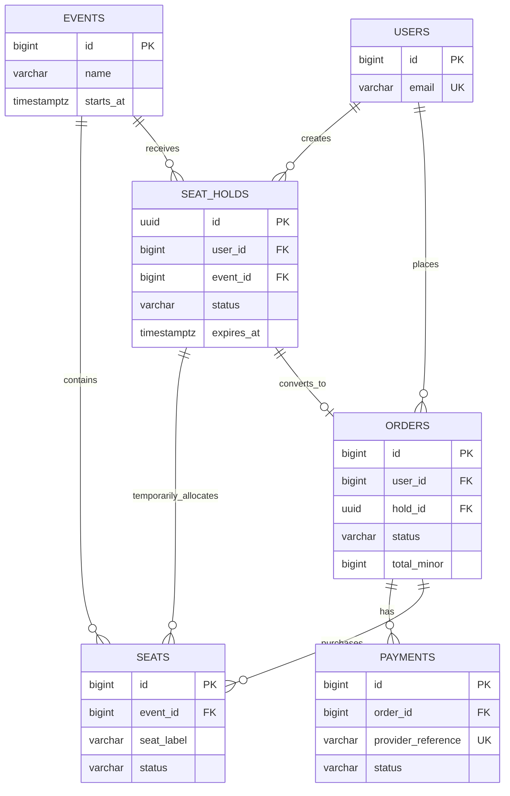
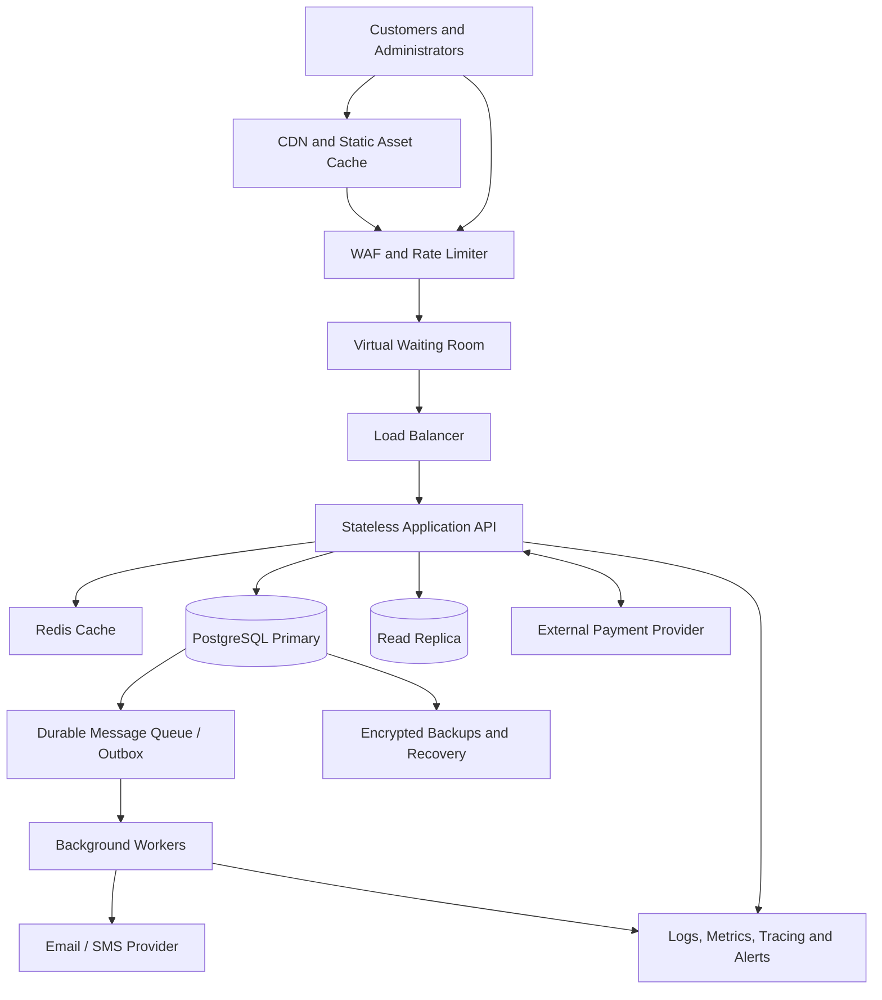

# TicketHub: Ticketing Platform System Design

## 1. Requirements

### 1.1 Overview

TicketHub is a web-based ticketing platform that allows users to discover events, view venue seating plans, select available seats, reserve seats temporarily, pay securely, and retrieve confirmed tickets.

The platform supports 2 million registered users, 50,000 daily visitors under normal conditions, and major ticket launches where 200,000 people attempt to purchase 20,000 seats within ten minutes.

The system must prioritize correctness and fairness while maintaining acceptable performance during sudden traffic spikes. Selling a seat twice is a critical business failure, so seat allocation and order confirmation must be protected by database-level consistency controls.

### 1.2 Functional requirements

1. **User accounts:** Users can register, sign in, and manage their account information.
2. **Event discovery:** Users can browse upcoming events, search by name or category, filter by date and location, and view event details.
3. **Seat availability:** Users can view venue seating layouts and identify available, held, sold, and temporarily unavailable seats.
4. **Seat reservation:** Authenticated users can select seats and hold them temporarily while completing checkout.
5. **Payment processing:** Users can initiate payment through an integrated payment provider and receive a clear payment status.
6. **Order management:** Users can view their orders, check payment status, and retrieve confirmed tickets.
7. **Ticket verification:** Each confirmed ticket has a unique identifier or QR code that can be validated at the venue.
8. **Notifications:** The system sends booking confirmations, payment updates, and reservation-expiry notifications where appropriate.
9. **Event administration:** Authorized administrators can create events, configure seating capacity, set prices, and monitor sales.
10. **Sales monitoring:** Administrators can view ticket sales, failed payments, remaining inventory, and suspicious booking activity.

### 1.3 Non-functional requirements

| Requirement | Design target | How it is achieved |
|---|---|---|
| Performance | Normal browsing API p95 latency below 300 ms, excluding external payment-provider time | Caching, indexed queries, connection pooling, and efficient APIs |
| Scalability | Support 50,000 daily visitors and bursts of 200,000 sale participants | Stateless application servers, autoscaling, a waiting room, and queues |
| Correctness | No seat can be sold to more than one customer | Database transactions, row locks, unique constraints, and conditional updates |
| Availability | Target 99.9% monthly availability, excluding agreed maintenance | Multiple application instances, health checks, redundancy, and recovery procedures |
| Fairness | Eligible users receive a fair, transparent opportunity to purchase tickets | Virtual waiting room, rate limits, and controlled admission |
| Security | Protect personal data, accounts, orders, and payments | HTTPS, authentication, authorization, input validation, and secure secrets management |
| Reliability | Avoid duplicate orders or charges when requests are retried | Idempotency keys, payment reconciliation, and durable records |
| Recoverability | Recover from infrastructure failures without losing confirmed orders | Database backups, replication, monitoring, and tested recovery procedures |
| Usability | Clearly communicate availability, queue status, reservation expiry, and payment results | Responsive interfaces, accessible controls, and useful error messages |

These figures are design objectives, not measured guarantees. They must be validated through load testing and production monitoring.

### 1.4 Correctness and fairness principles

TicketHub must distinguish between a seat being viewed, temporarily held, and permanently sold. Viewing a seat does not reserve it.

A seat becomes unavailable to other buyers only when the database successfully records an active hold or a completed sale. Expired holds must be released safely, and confirmed sales must never be reversed merely because a payment notification is delayed.

For popular sales, the waiting room limits the number of concurrent users reaching the booking system. Admission should follow a published policy, such as first-come-first-served queue admission, with clear queue positions or progress indicators where practical. Rate limits, per-user purchase limits, and abuse detection discourage bots and bulk purchasing.

## 2. Traffic and Capacity Estimates

All calculations below use the supplied assignment figures. Request-rate calculations assume traffic is spread evenly across the stated time period unless otherwise specified. Actual traffic will fluctuate, particularly during a popular concert launch.

### 2.1 Normal daily traffic

Given:

- Registered users: 2,000,000
- Daily visitors: 50,000
- Pages viewed per visitor: 10
- Tickets sold per day: 5,000

**Daily page views**

50,000 visitors × 10 pages = 500,000 page views per day.

**Average page-view rate**

500,000 ÷ 86,400 seconds ≈ 5.79 page views per second.

**Average daily visitor arrival rate**

50,000 ÷ 86,400 ≈ 0.58 visitors per second.

**Average ticket sales rate**

5,000 ÷ 86,400 ≈ 0.058 tickets per second.

This is approximately one ticket sold every 17.3 seconds on average.

For an illustrative API workload estimate, assume each page view generates three backend API requests on average. This is an additional planning assumption, not a supplied fact.

500,000 page views × 3 requests = 1,500,000 API requests per day.

1,500,000 ÷ 86,400 ≈ 17.36 API requests per second on average.

Real API traffic may be higher because of polling, retries, seat-map updates, and checkout operations. Static assets served by a CDN should not all reach the application servers.

### 2.2 Popular concert sale

Given:

- People attempting to buy tickets: 200,000
- Available seats: 20,000
- Sale window: 10 minutes = 600 seconds

**Average buyer arrival rate**

200,000 ÷ 600 ≈ 333.33 buyer attempts per second.

**Seat supply per second**

20,000 ÷ 600 ≈ 33.33 seats per second if all seats were sold evenly across the ten-minute period.

**Demand-to-supply ratio**

200,000 ÷ 20,000 = 10 potential buyers per seat.

Only 20,000 of the 200,000 participants can obtain one of the available seats if each participant purchases one seat and all seats are sold. The maximum conversion rate under these assumptions is 10%.

The average arrival rate does not represent the instantaneous peak. If many buyers arrive in the first few seconds, actual request rates can be substantially higher.

For capacity planning, TicketHub should test at least a 3× burst over the average sale arrival rate:

333.33 × 3 ≈ 1,000 buyer attempts per second.

This is a proposed stress-test target, not a measured peak or a guarantee that each attempt generates only one request. A buyer may generate multiple API calls.

### 2.3 Normal traffic versus a big sale

| Metric | Normal day | Popular concert sale |
|---|---:|---:|
| Relevant audience | 50,000 daily visitors | 200,000 buyer attempts |
| Observation period | 24 hours | 10 minutes |
| Average visitor/buyer arrival rate | 0.58/s | 333.33/s |
| Page views | 500,000/day | Not specified |
| Estimated API requests | 1.5 million/day under the three-request assumption | Must be measured and load-tested |
| Ticket supply | 5,000 sold/day | 20,000 seats |
| Primary risk | General performance and availability | Contention, overload, unfair access, and double-booking |

The sale's average buyer arrival rate is approximately 576 times the normal daily visitor arrival rate. This comparison illustrates why the system needs a waiting room, controlled admission, and protected inventory operations rather than simply adding more web servers.

### 2.4 Capacity planning strategy

1. Serve event pages, images, venue information, and other relatively static content through a CDN and cache.
2. Place a virtual waiting room before the checkout and seat-hold services.
3. Admit a controlled number of users based on measured database and payment-service capacity.
4. Scale stateless application servers horizontally.
5. Protect inventory-changing database operations with short transactions and appropriate indexes.
6. Move non-critical tasks, such as email and analytics, to asynchronous workers.
7. Monitor request rate, latency, database locks, queue depth, payment failures, and seat-hold conflicts.
8. Perform load and stress tests using realistic browsing, queue, hold, payment, and retry patterns.

## 3. API Design

TicketHub exposes a versioned REST API under `/api/v1`. Requests and responses use JSON unless a file download or other content type is explicitly required.

All endpoints use HTTPS. Endpoints that access personal orders or change inventory require authentication and authorization. Requests that create or repeat a payment operation use idempotency keys.

### 3.1 Endpoint summary

| Method and endpoint | Purpose | Access |
|---|---|---|
| GET `/api/v1/events` | List, search, and filter published events | Public |
| GET `/api/v1/events/{eventId}` | Retrieve event details and sale information | Public |
| GET `/api/v1/events/{eventId}/seats` | Retrieve seat-map data and current availability | Public or queue-authorized, depending on sale policy |
| POST `/api/v1/seat-holds` | Attempt to hold one or more seats temporarily | Authenticated and admitted user |
| GET `/api/v1/seat-holds/{holdId}` | Check hold status and expiry | Hold owner |
| DELETE `/api/v1/seat-holds/{holdId}` | Release an active hold before expiry | Hold owner |
| POST `/api/v1/orders` | Create an order from a valid active hold | Authenticated hold owner |
| POST `/api/v1/orders/{orderId}/payments` | Initiate payment for an order | Authorized order owner |
| POST `/api/v1/payments/webhook` | Receive verified payment-provider updates | Payment provider, verified server-to-server |
| GET `/api/v1/me/orders` | List the signed-in user's orders | Authenticated user |
| GET `/api/v1/me/tickets` | Retrieve the user's confirmed tickets | Authenticated user |

### 3.2 Example request and response

**A. Browse events**

`GET /api/v1/events?date=2026-12-20&category=concert&page=1`

Example response:

```json
{
  "items": [
    {
      "id": "evt_101",
      "name": "Summer Music Festival",
      "venue": "City Arena",
      "starts_at": "2026-12-20T18:00:00Z",
      "currency": "KES"
    }
  ],
  "page": 1,
  "has_more": false
}
```

**B. View seat availability**

`GET /api/v1/events/evt_101/seats`

Example response:

```json
{
  "event_id": "evt_101",
  "seats": [
    {
      "id": "seat_A12",
      "section": "A",
      "label": "A12",
      "price_minor": 250000,
      "currency": "KES",
      "status": "available"
    }
  ],
  "as_of": "2026-12-01T10:00:00Z"
}
```

The price is expressed in minor currency units: `250000` means KES 2,500.00 if the currency uses 100 minor units per shilling. Availability is a snapshot and is not a promise that the seat will remain available until a hold succeeds.

**C. Hold seats**

`POST /api/v1/seat-holds`

```json
{
  "event_id": "evt_101",
  "seat_ids": ["seat_A12"],
  "request_id": "hold-request-unique-123"
}
```

Example success response:

```json
{
  "hold_id": "hold_501",
  "status": "active",
  "expires_at": "2026-12-20T17:10:00Z",
  "seat_ids": ["seat_A12"]
}
```

A successful response is returned only after the database has committed the hold. If another customer already holds or has purchased the seat, the API returns `409 Conflict` without allocating the same seat.

**D. Create an order**

`POST /api/v1/orders`

```json
{
  "hold_id": "hold_501"
}
```

Example response:

```json
{
  "order_id": "ord_9001",
  "status": "pending_payment",
  "total_minor": 250000,
  "currency": "KES"
}
```

The server calculates prices from trusted database records rather than accepting a client-supplied total.

**E. Initiate payment**

`POST /api/v1/orders/ord_9001/payments`

Headers:

`Idempotency-Key: pay-ord-9001-attempt-1`

Example request:

```json
{
  "payment_method": "mobile_money"
}
```

Example response:

```json
{
  "payment_id": "pay_7001",
  "status": "pending",
  "message": "Complete the payment request using the payment provider."
}
```

The response means payment was initiated, not that payment succeeded. A verified provider callback or an authoritative provider-status check determines the final payment result.

**F. View confirmed tickets**

`GET /api/v1/me/tickets`

Example response:

```json
{
  "items": [
    {
      "ticket_id": "tkt_6001",
      "event_id": "evt_101",
      "seat_id": "seat_A12",
      "status": "confirmed",
      "qr_token": "example-opaque-token"
    }
  ]
}
```

Real ticket tokens must be securely generated, unpredictable, and validated server-side. Example identifiers and tokens above are illustrative only.

### 3.3 API error handling and reliability

- `400 Bad Request`: Invalid input or malformed JSON.
- `401 Unauthorized`: Missing or invalid authentication.
- `403 Forbidden`: The user lacks permission or has not met the sale's admission requirements.
- `404 Not Found`: The event, hold, order, or ticket does not exist or is not visible to the requester.
- `409 Conflict`: A seat is no longer available, a hold has expired, or an order cannot transition to the requested state.
- `410 Gone`: A reservation has expired, where this distinction is useful to clients.
- `422 Unprocessable Entity`: A well-formed request violates a business rule.
- `429 Too Many Requests`: The user has exceeded a rate limit.
- `503 Service Unavailable`: The service is overloaded or temporarily unavailable.

Responses should include a stable error code and a safe, human-readable message. Retryable operations must use idempotency keys where appropriate. Clients should not automatically retry payment requests using new keys after a timeout, because the original payment may already be processing.

## 4. Data Model

TicketHub uses a relational database such as PostgreSQL for users, events, seat inventory, holds, orders, and payments. A relational database is appropriate because seat allocation requires strong consistency, foreign-key relationships, transactions, and uniqueness constraints.

### 4.1 Tables

#### Table 1: `users`

| Column | Type | Constraints and purpose |
|---|---|---|
| `id` | BIGINT | Primary key |
| `full_name` | VARCHAR(150) | User's display name |
| `email` | VARCHAR(255) | Unique, required |
| `password_hash` | VARCHAR(255) | Required; never store plain-text passwords |
| `created_at` | TIMESTAMPTZ | Account creation timestamp |
| `status` | VARCHAR(20) | Account status |

#### Table 2: `events`

| Column | Type | Constraints and purpose |
|---|---|---|
| `id` | BIGINT | Primary key |
| `name` | VARCHAR(200) | Required event name |
| `description` | TEXT | Event details |
| `venue` | VARCHAR(200) | Venue name |
| `starts_at` | TIMESTAMPTZ | Event start time |
| `sale_starts_at` | TIMESTAMPTZ | Ticket sale opening time |
| `status` | VARCHAR(20) | Draft, published, cancelled, or completed |
| `created_at` | TIMESTAMPTZ | Record creation time |

#### Table 3: `seats`

Each row represents a specific sellable seat for an event. This design treats an event's sellable seat inventory as event-specific, even if several events use the same physical venue.

| Column | Type | Constraints and purpose |
|---|---|---|
| `id` | BIGINT | Primary key |
| `event_id` | BIGINT | Foreign key to `events.id` |
| `section` | VARCHAR(50) | Venue section |
| `seat_label` | VARCHAR(30) | Seat label, such as A12 |
| `price_minor` | BIGINT | Non-negative price in minor currency units |
| `currency` | CHAR(3) | Currency code, such as KES |
| `status` | VARCHAR(20) | Available, held, or sold |
| `hold_id` | UUID, nullable | References the active hold, when present |
| `hold_expires_at` | TIMESTAMPTZ, nullable | Expiry time of the active hold |
| `sold_order_id` | BIGINT, nullable | Order that purchased the seat |
| `version` | BIGINT | Optional optimistic-concurrency version |

Constraints:

- Primary key: `id`.
- Foreign key: `event_id` references `events.id`.
- Unique constraint: `(event_id, section, seat_label)`.
- Check constraint: `price_minor >= 0`.
- A sold seat must have a valid order reference.
- A held seat must have a valid hold reference and expiry time.

The seat status is a convenient representation of current inventory state. The application must update it through controlled transactions rather than trusting values supplied by the browser.

#### Table 4: `seat_holds`

| Column | Type | Constraints and purpose |
|---|---|---|
| `id` | UUID | Primary key |
| `user_id` | BIGINT | Foreign key to `users.id` |
| `event_id` | BIGINT | Foreign key to `events.id` |
| `status` | VARCHAR(20) | Active, converted, released, or expired |
| `created_at` | TIMESTAMPTZ | Hold creation time |
| `expires_at` | TIMESTAMPTZ | Hold expiry time |

A hold represents one reservation attempt. The corresponding seat records reference the active hold. The service enforces maximum seats per hold and maximum purchases per user.

#### Table 5: `orders`

| Column | Type | Constraints and purpose |
|---|---|---|
| `id` | BIGINT | Primary key |
| `user_id` | BIGINT | Foreign key to `users.id` |
| `hold_id` | UUID | Foreign key to `seat_holds.id` |
| `status` | VARCHAR(30) | Pending payment, confirmed, failed, cancelled, or expired |
| `total_minor` | BIGINT | Total amount in minor currency units |
| `currency` | CHAR(3) | Currency code |
| `idempotency_key` | VARCHAR(255) | Unique within the relevant user or operation scope |
| `created_at` | TIMESTAMPTZ | Order creation time |
| `updated_at` | TIMESTAMPTZ | Last status update |

An order should preserve a record of the amount and currency agreed at checkout. A production system may also store order line items and price snapshots explicitly.

#### Table 6: `payments`

| Column | Type | Constraints and purpose |
|---|---|---|
| `id` | BIGINT | Primary key |
| `order_id` | BIGINT | Foreign key to `orders.id` |
| `provider_reference` | VARCHAR(255) | Unique provider transaction reference when available |
| `idempotency_key` | VARCHAR(255) | Unique for a payment operation within its defined scope |
| `amount_minor` | BIGINT | Amount requested or received |
| `currency` | CHAR(3) | Currency code |
| `status` | VARCHAR(30) | Pending, succeeded, failed, or refunded |
| `created_at` | TIMESTAMPTZ | Payment initiation time |
| `updated_at` | TIMESTAMPTZ | Last payment update |

A production implementation should additionally persist verified provider webhook identifiers or deduplication keys so that repeated callbacks cannot apply the same payment transition more than once.

### 4.2 Relationships



The diagram shows the main relationships. In a concrete database implementation, `seats.sold_order_id` references `orders.id`, while `seats.hold_id` references `seat_holds.id`. A composite foreign key or equivalent validation should ensure that a hold and its seats belong to the same event.

The `seat_holds` to `orders` relationship may be enforced as one order per hold using a unique constraint on `orders.hold_id`. An order may have multiple payment attempts, but only one successful payment should be accepted for the amount due unless the business explicitly supports partial or split payments.

### 4.3 Database constraints

The database, rather than the browser or application memory, is the final authority for inventory allocation.

Important constraints include:

- Unique event-and-seat labels to prevent duplicate inventory records.
- Foreign keys to prevent orders, payments, and holds from referencing nonexistent records.
- Non-negative price and amount checks.
- Unique order idempotency keys within their intended scope.
- Unique payment-provider transaction references.
- A unique order reference for a seat's completed sale, with the seat's single `sold_order_id` as the canonical ownership record.
- Conditional state-transition rules that prevent sold seats from returning to the available state through ordinary hold-expiry processing.

Database checks and indexes should be designed around the actual PostgreSQL schema. Rules involving several rows or timestamps must be enforced through transactions and conditional updates where a simple check constraint is insufficient.

## 5. Preventing Double-Booking

### 5.1 The problem

Suppose Alice and Brian both view seat A12 at nearly the same time. Both browsers show the seat as available. If the application simply checks availability and then updates the seat without an atomic operation, both requests might pass the check and both customers might receive confirmation.

This is a race condition: the correctness of the result depends on the order in which concurrent operations execute.

TicketHub must never rely on the seat map, an in-memory flag, or a separate availability check as proof that a seat has been reserved.

### 5.2 Atomic seat-hold transaction

The seat-hold service uses a database transaction to lock the requested seat rows, check their current state, and claim them atomically.

Conceptual PostgreSQL-style pseudocode:

```sql
BEGIN;

-- Lock requested seats in a consistent order.
SELECT id, event_id, status, hold_id, hold_expires_at
FROM seats
WHERE event_id = :event_id
  AND id = ANY(:seat_ids)
ORDER BY id
FOR UPDATE;

-- In application transaction logic:
-- 1. Verify every requested seat exists.
-- 2. Verify the user is authorized and admitted.
-- 3. Verify each seat is available, or its prior hold
--    has expired and is safely eligible for reclamation.
-- 4. Reject the entire request if any seat cannot be claimed.

INSERT INTO seat_holds (
    id, user_id, event_id, status, created_at, expires_at
)
VALUES (
    :hold_id, :user_id, :event_id, 'active',
    CURRENT_TIMESTAMP,
    CURRENT_TIMESTAMP + INTERVAL '5 minutes'
);

UPDATE seats
SET status = 'held',
    hold_id = :hold_id,
    hold_expires_at = CURRENT_TIMESTAMP + INTERVAL '5 minutes'
WHERE event_id = :event_id
  AND id = ANY(:seat_ids);

-- Verify that the update affected exactly the requested
-- number of seats before committing.
COMMIT;
```

The pseudocode is illustrative and must be implemented with appropriate checks, exception handling, foreign keys, and rollback logic. A production implementation should also verify that the number of requested IDs matches the number of unique seats found and that every seat belongs to the specified event.

The row locks ensure that two transactions cannot simultaneously claim the same locked seat. One transaction proceeds first; the other waits and then sees the committed state. If any seat is unavailable, the entire multi-seat hold request is rolled back.

An alternative implementation can use a conditional atomic `UPDATE` with a predicate requiring an available seat and then verify the affected-row count. Either approach must make the check-and-claim operation atomic.

### 5.3 Why the transaction works

1. Alice and Brian request seat A12.
2. Alice's transaction locks A12 first.
3. Alice's transaction changes the seat from `available` to `held` and commits.
4. Brian's transaction obtains the lock afterward and sees that A12 is held.
5. Brian receives `409 Conflict`; no second hold is created for that seat.

The database transaction and row lock serialize conflicting seat allocations. A unique constraint on `(event_id, section, seat_label)` prevents duplicate inventory definitions, while the canonical seat row and controlled state transitions prevent multiple customers from owning the same seat.

### 5.4 Hold expiry

A hold lasts five minutes in this design, although the duration is a configurable business rule.

An expired hold is not released merely because the clock has passed its expiry timestamp. A cleanup worker or a new hold request must perform the release using a transaction that locks the seat and verifies all of the following:

- The seat is still held.
- The seat still references the expiring hold.
- The hold is still active and has actually expired.
- The seat has not been sold or converted to a confirmed order.

The service then marks the hold expired and returns eligible seats to `available`. Checking the hold identifier prevents a delayed cleanup job from releasing a newer customer's hold.

The same rule applies when a payment is in progress: an uncertain payment result must not cause the system to free a seat that might already have been paid for. TicketHub must reconcile payment status with the provider before making a final inventory decision.

### 5.5 From hold to confirmed sale

The order-confirmation process must also be transactional.

1. Create an order from a valid active hold.
2. Initiate payment through the payment provider using an idempotency key.
3. Verify payment success through a signed provider webhook or authoritative status lookup.
4. Lock the order, hold, and affected seats in a consistent order.
5. Check that the payment amount and currency match the order and that the hold is still valid for confirmation under the documented payment policy.
6. Mark the payment successful, the order confirmed, the hold converted, and the seats sold in one database transaction.
7. Generate or enable confirmed tickets and schedule notifications after the transaction commits.

If any database operation fails, the local transaction rolls back. The system then reconciles the provider's payment state instead of assuming that a successful external charge was undone by the database rollback.

A transactional outbox can reliably schedule ticket generation and notification events after a committed order without attempting to send emails inside the inventory transaction.

### 5.6 Handling retries and payment failures

- **Repeated order request:** Return the original order for the same idempotency key and request scope.
- **Repeated payment request:** Reuse the same payment operation when the request is a retry of the same intended payment.
- **Repeated webhook:** Deduplicate the provider event and apply each valid state transition once.
- **Payment timeout:** Treat the result as unknown until reconciled; do not immediately create a second charge.
- **Definitive payment failure:** Mark the attempt failed and follow the documented hold policy. Release the seat only when doing so is safe.
- **Delayed successful payment:** Apply a consistent policy for late payments, such as reconciling the charge, completing a still-valid reservation, or issuing a refund when the seat can no longer be honored.

This design separates the database's atomic guarantees from the payment provider's external behavior. A database transaction cannot make a network payment reversible, so idempotency, reconciliation, and explicit state transitions are essential.

## 6. System Architecture

### 6.1 Architecture diagram



The diagram is a logical architecture. In production, database access would be routed by operation: inventory-changing transactions go to the primary, while eligible read-only queries can use the replica. The application should not send stale replica results into a seat-allocation decision.

### 6.2 Component responsibilities

**1. Customers and administrators**

Customers browse events, join queues, reserve seats, and pay. Administrators manage events and monitor sales. Role-based authorization restricts administrative operations.

**2. CDN and static asset cache**

The CDN serves images, CSS, JavaScript, and cacheable event content from edge locations. It reduces latency and protects the origin from repetitive requests. Dynamic seat availability and personalized account data require appropriate caching controls.

**3. Web application firewall and rate limiter**

The WAF filters common malicious requests, while rate limiting restricts abusive request patterns. Authentication, bot detection, purchase limits, and monitoring provide additional protection. Rate limits must be fair and should not penalize legitimate customers solely because they share a public IP address.

**4. Virtual waiting room**

The waiting room controls admission to high-demand sales. It can issue signed, short-lived admission tokens and admit users at a rate that the booking and payment systems can sustain. It reduces the number of concurrent requests competing for the same inventory.

Queue fairness should be explicit. A first-come-first-served policy may be used where users join before or at sale opening. If a randomized allocation window is used instead, that policy must be disclosed and applied consistently.

**5. Load balancer**

The load balancer distributes admitted traffic among healthy application instances. Health checks remove failed instances, and horizontal scaling adds capacity when demand increases.

**6. Stateless application API**

Application instances implement event browsing, seat holds, orders, authentication, and payment orchestration. They keep no essential reservation state solely in local memory. This allows requests to move between instances without losing booking information.

**7. Redis cache**

Redis can cache event descriptions, venue layouts, and other frequently accessed data. It can also support carefully designed rate-limiting and queue metadata. Redis is not the authoritative source for seat ownership; PostgreSQL remains responsible for transactional inventory decisions.

**8. PostgreSQL primary database**

The primary stores users, events, seats, holds, orders, and payments. Transactions, row-level locks, foreign keys, and unique constraints enforce consistency. Connection pooling and short transactions reduce database contention.

**9. Read replica**

The read replica serves suitable read-heavy workloads, such as event listings and reporting. Replication lag means its data may be stale. Hold creation, order confirmation, and any decision requiring current ownership must use the authoritative primary or an equivalent strongly consistent mechanism.

**10. External payment provider**

The payment provider processes customer payments. TicketHub stores provider references and verified payment states but never stores raw card security codes. Provider callbacks must be authenticated, validated, and deduplicated.

**11. Durable queue, transactional outbox, and workers**

Background workers send notifications, generate ticket documents, and process analytics. The outbox pattern prevents a committed order from being lost merely because publishing a message failed. Workers must be idempotent because messages can be delivered more than once.

**12. Monitoring and recovery**

Centralized logs, metrics, tracing, alerts, encrypted backups, and tested restoration procedures help detect and recover from incidents. Important measurements include queue depth, admission rate, API p95 and p99 latency, database lock waits, hold conflicts, payment reconciliation backlog, and error rates.

### 6.3 How the architecture survives a big sale

During a popular sale, 200,000 buyer attempts arrive over ten minutes, averaging approximately 333 per second. TicketHub does not allow all participants to hit the inventory database simultaneously.

The CDN absorbs much of the static-content traffic, while the waiting room regulates admission to the booking flow. Stateless application instances scale horizontally, and cached event information reduces repeated reads. The database uses short transactions and locks only the seat rows needed for each reservation.

The platform also limits seats per order, applies purchase rules consistently, and monitors contention. If the system reaches its safe capacity, the queue grows and customers receive clear waiting information rather than overwhelming the database. Non-critical work is processed asynchronously, while inventory and payment records remain durable.

Capacity should be increased only after load tests establish safe limits for database connections, lock contention, payment-provider throughput, and queue admission. Autoscaling alone cannot eliminate contention over a finite number of seats.

## 7. Architectural Trade-offs

### Trade-off 1: Strong consistency versus availability and latency

**Decision:** Use PostgreSQL transactions and locks for seat allocation and order confirmation.

**Advantages:** Prevents concurrent buyers from successfully claiming the same seat and provides clear ownership records.

**Disadvantages:** Contending transactions may wait, increasing checkout latency during a popular sale. The primary database can become a bottleneck, and strict consistency can reduce the ability to continue writes during certain failures.

**Mitigation:** Keep transactions short, lock seats in a consistent order, index lookup fields, limit concurrent admission, and load-test contention. Availability information can be cached, but final allocation must be verified against authoritative inventory.

### Trade-off 2: Fair access versus maximum throughput

**Decision:** Use a virtual waiting room and controlled admission for high-demand events.

**Advantages:** Reduces overload, improves predictability, and provides a transparent process for allocating limited purchasing opportunities.

**Disadvantages:** Customers may wait even when some system capacity is available. Queue infrastructure adds complexity, and strict queue ordering can be affected by reconnects, network delays, or abuse.

**Mitigation:** Publish the admission policy, use signed queue tokens, provide status updates, apply purchase limits, and monitor queue behavior. Any randomized admission policy should be clearly disclosed.

### Trade-off 3: Caching versus freshness

**Decision:** Cache relatively static event information and use read replicas for suitable read-heavy queries.

**Advantages:** Reduces database load, improves response time, and supports more browsing traffic.

**Disadvantages:** Cached content or replica results may be stale. A customer may see a seat listed as available after another customer has held it.

**Mitigation:** Label seat availability as a snapshot and make the hold endpoint authoritative. Never confirm a reservation using cached availability alone.

### Trade-off 4: Synchronous work versus asynchronous processing

**Decision:** Confirm critical database state synchronously, but send notifications and process analytics asynchronously.

**Advantages:** Keeps checkout transactions short and prevents slow email or SMS services from blocking successful bookings.

**Disadvantages:** Notifications may arrive late, queues may accumulate, and background jobs require retry and deduplication logic.

**Mitigation:** Use a durable outbox, idempotent workers, dead-letter handling, queue monitoring, and operational alerts. Ticket confirmation must be based on committed order state, not successful delivery of a notification.

## 8. Security, Monitoring, and Operational Risks

TicketHub should use secure password hashing, HTTPS, least-privilege database accounts, server-side input validation, and role-based access control. Payment callbacks must be authenticated and verified according to the provider's requirements. Sensitive information must not appear in application logs.

The platform should also defend against credential stuffing, automated queue abuse, replayed requests, forged payment callbacks, and ticket QR-code duplication. Ticket validation at the venue must check the authoritative ticket status and reject tickets that have already been used where single-entry rules apply.

Key operational alerts should cover:

- Rising API latency and error rates.
- Excessive database lock waits or exhausted connection pools.
- Abnormally high hold-conflict rates.
- Growing waiting-room or message-queue backlogs.
- Payment-provider timeouts and unreconciled transactions.
- Unexpected changes in available inventory or duplicate-payment indicators.

Before launch, the team should conduct load tests, concurrency tests involving the same seat, payment-timeout and webhook-replay tests, database failover exercises, and backup-restoration tests.

## 9. Conclusion

TicketHub is designed around the central challenge of selling a limited inventory to a much larger audience without overselling seats. Its architecture separates high-volume browsing from strongly consistent booking operations, uses a waiting room to control admission, and relies on database transactions and constraints to enforce exclusive seat ownership.

Caching, horizontal scaling, asynchronous processing, payment idempotency, and monitoring improve performance and resilience. Most importantly, a seat is considered sold only after a valid transaction records the confirmed purchase. These measures provide a practical foundation for a scalable, fair, and reliable ticketing platform.